

# Panels Assistive

### Smart Floating Tools · Custom Panels · Quick Controls

**A customizable Android utility that brings useful tools and shortcuts closer to your fingertips.**

**Ứng dụng tiện ích Android tùy biến, đưa các công cụ và phím tắt đến gần thao tác của bạn hơn.**

---

## About the app | Giới thiệu

**EN**  
Panels Assistive is an Android utility focused on floating access, quick actions and personal customization. It combines a floating ball, configurable panels, gesture shortcuts, widgets and system-control shortcuts in one place. The goal is to reduce repeated navigation and make frequently used tools easier to reach.

**VI**  
Panels Assistive là ứng dụng tiện ích Android tập trung vào truy cập nổi, thao tác nhanh và cá nhân hóa. Ứng dụng kết hợp bóng nổi, bảng tiện ích có thể tùy chỉnh, thao tác cử chỉ, widget và các phím tắt điều khiển hệ thống. Mục tiêu là giảm thao tác chuyển màn hình và giúp truy cập công cụ thường dùng thuận tiện hơn.

---

## Accessibility is optional for basic use | Không bắt buộc bật Trợ năng để dùng cơ bản

**EN**  
The app's basic features can be used without enabling Android Accessibility Services. Accessibility access is only needed for actions that specifically depend on it, such as certain system-navigation or screen-interaction shortcuts. Available actions may vary by Android version and device manufacturer.

**VI**  
Các chức năng cơ bản của ứng dụng có thể sử dụng mà không cần bật Dịch vụ trợ năng Android. Quyền Trợ năng chỉ cần cho những thao tác phụ thuộc vào quyền này, chẳng hạn một số phím tắt điều hướng hệ thống hoặc tương tác với màn hình. Các thao tác khả dụng có thể khác nhau tùy phiên bản Android và nhà sản xuất.

---

## Main features | Tính năng chính

### 1. Floating ball | Bóng nổi

**EN**
- Keep a floating shortcut accessible above other apps.
- Customize its appearance, size, opacity and position.
- Use images or GIF-style visuals where supported.
- Configure quick actions for convenient access.

**VI**
- Hiển thị nút nổi để truy cập nhanh khi đang dùng ứng dụng khác.
- Tùy chỉnh giao diện, kích thước, độ trong suốt và vị trí.
- Có thể dùng hình ảnh hoặc GIF nếu được hỗ trợ.
- Thiết lập thao tác nhanh để truy cập tiện ích thuận tiện hơn.

  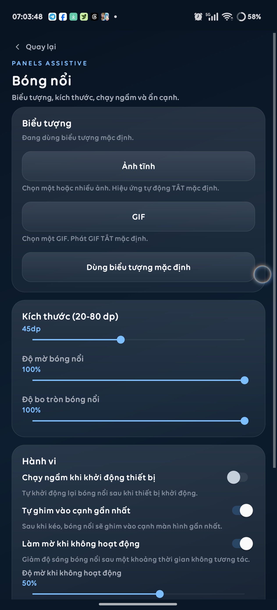

### 2. Custom panels | Bảng tiện ích tùy chỉnh

**EN**
- Configure panels and choose the quick tools shown in them.
- Adjust panel appearance and interaction settings.
- Add or arrange available shortcuts to suit your workflow.

**VI**
- Tùy chỉnh bảng và lựa chọn các công cụ nhanh hiển thị bên trong.
- Điều chỉnh giao diện và cách tương tác với bảng.
- Thêm hoặc sắp xếp các phím tắt theo nhu cầu sử dụng.

  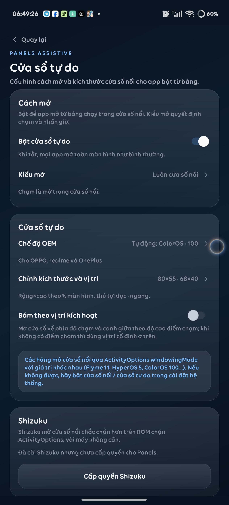
  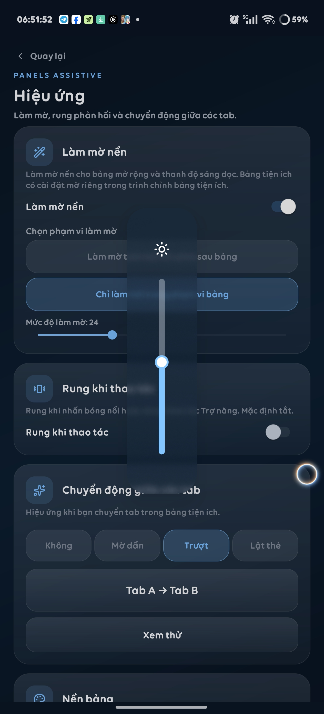
  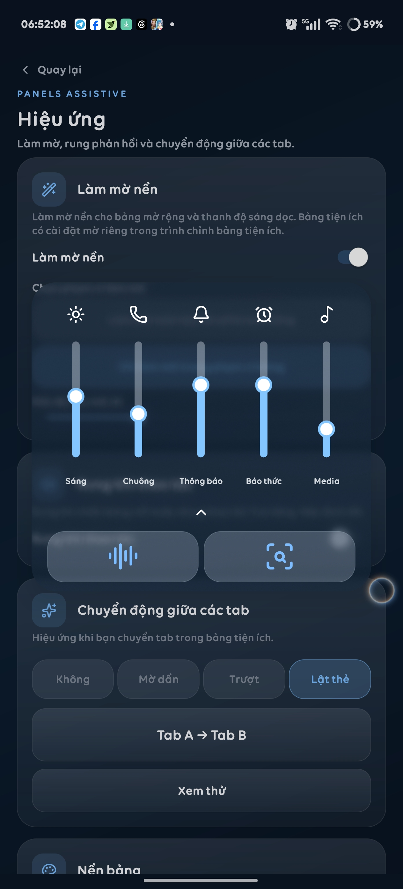

### 3. Quick controls | Điều khiển nhanh

**EN**
- Quick access to brightness and volume controls.
- Media-related controls and shortcuts.
- Additional actions depend on the device and granted permissions.

**VI**
- Truy cập nhanh điều khiển độ sáng và âm lượng.
- Các nút điều khiển và phím tắt liên quan đến đa phương tiện.
- Một số thao tác bổ sung phụ thuộc thiết bị và quyền đã cấp.

  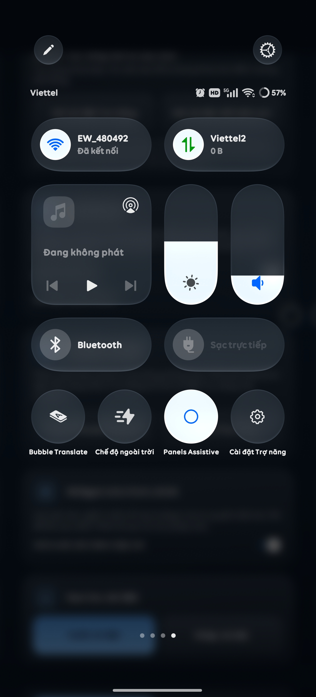
  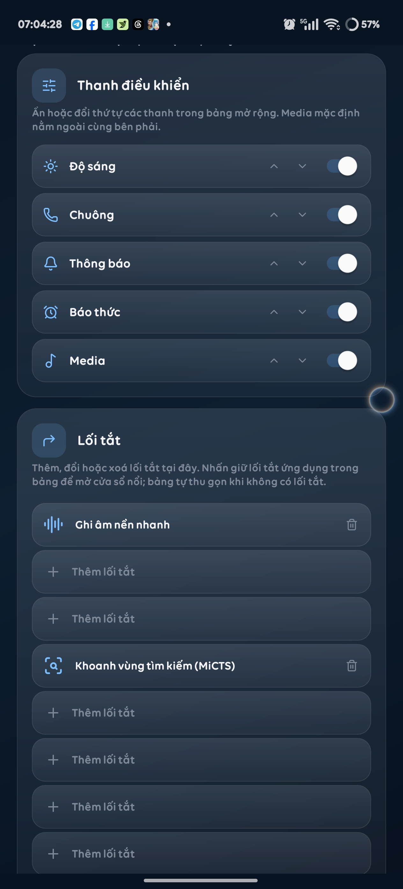

### 4. Gesture shortcuts | Phím tắt cử chỉ

**EN**
- Assign actions to single tap, double tap, triple tap or long press where available.
- Choose from the actions provided by the app.
- Gesture availability may depend on the selected trigger and system restrictions.

**VI**
- Gán hành động cho chạm một lần, chạm hai lần, chạm ba lần hoặc nhấn giữ nếu được hỗ trợ.
- Lựa chọn trong danh sách hành động do ứng dụng cung cấp.
- Khả năng sử dụng cử chỉ phụ thuộc vào vị trí kích hoạt và giới hạn của hệ thống.

  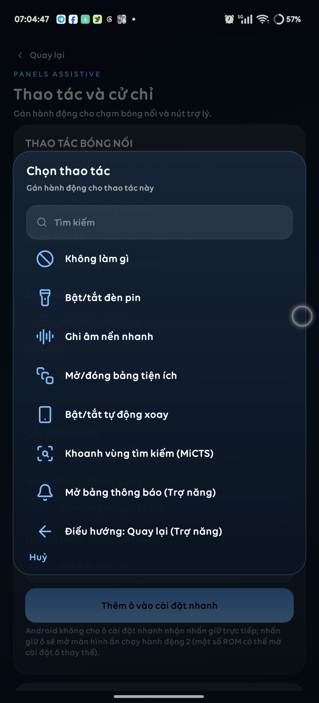
  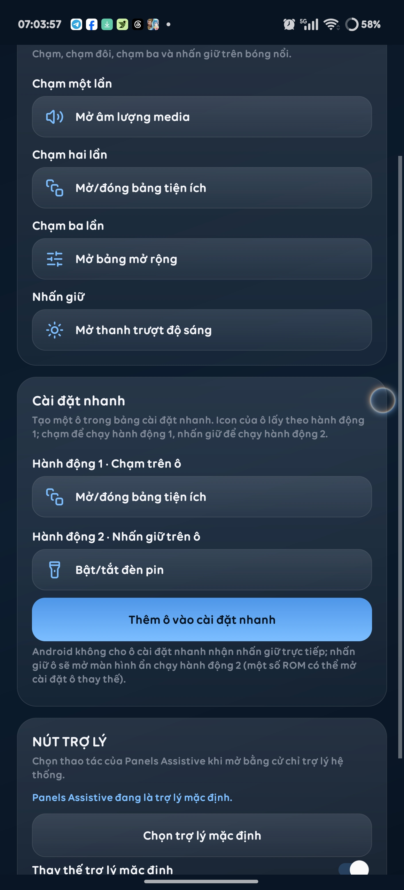

### 5. Quick recording | Ghi âm nhanh

**EN**
- Start and control an audio recording from the app interface.
- Access recording playback and available file actions.
- Microphone permission is required for recording.

**VI**
- Bắt đầu và điều khiển ghi âm ngay từ giao diện ứng dụng.
- Truy cập phát lại bản ghi và các thao tác tệp được hỗ trợ.
- Cần cấp quyền micro để sử dụng chức năng ghi âm.

  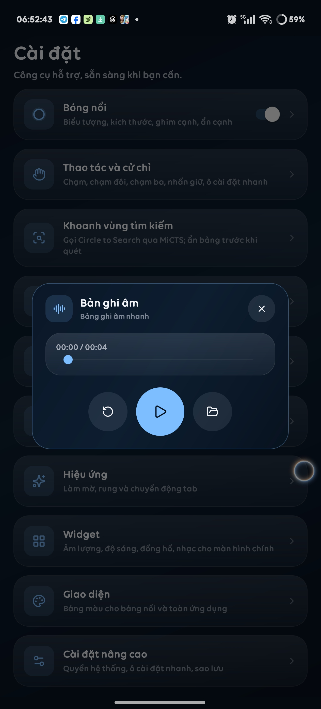
  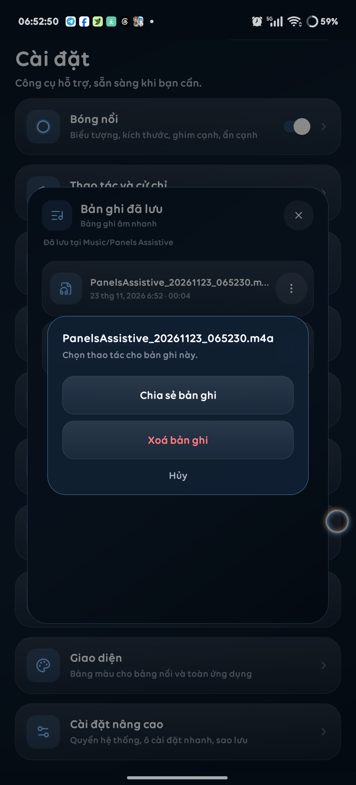

### 6. Widgets and music | Widget và âm nhạc

**EN**
- Configure available home-screen widgets.
- Access clock and media-related widget options.
- Display a media player overlay when supported by the device and media app.

**VI**
- Cấu hình các widget màn hình chính được cung cấp.
- Truy cập các tùy chọn widget đồng hồ và đa phương tiện.
- Hiển thị lớp điều khiển trình phát nhạc nổi khi thiết bị và ứng dụng phát nhạc hỗ trợ.

  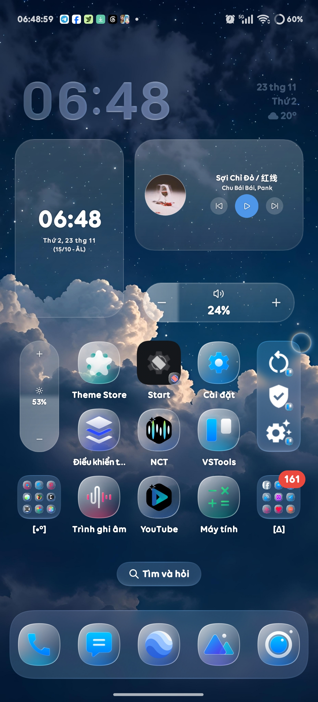
  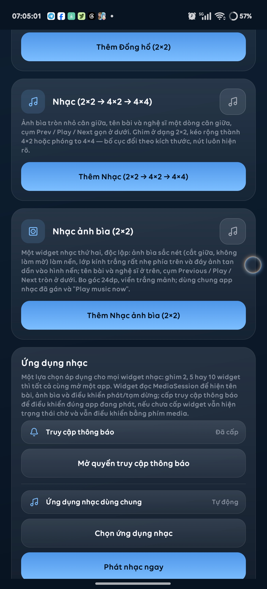
  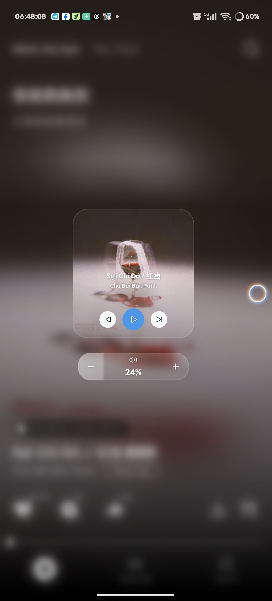
  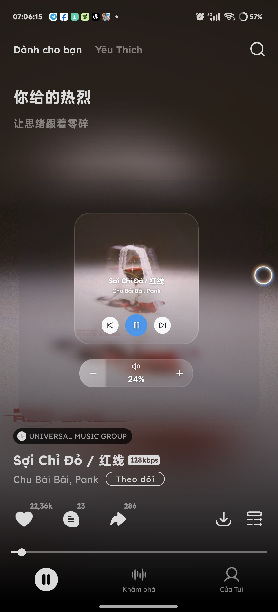

### 7. Appearance and personalization | Giao diện và cá nhân hóa

**EN**
- Adjust visual options such as transparency, blur, colors and panel appearance where available.
- Personalize the experience to better match your device and preferences.

**VI**
- Điều chỉnh các tùy chọn hiển thị như độ trong suốt, làm mờ, màu sắc và giao diện bảng nếu có.
- Cá nhân hóa trải nghiệm để phù hợp hơn với thiết bị và sở thích.

  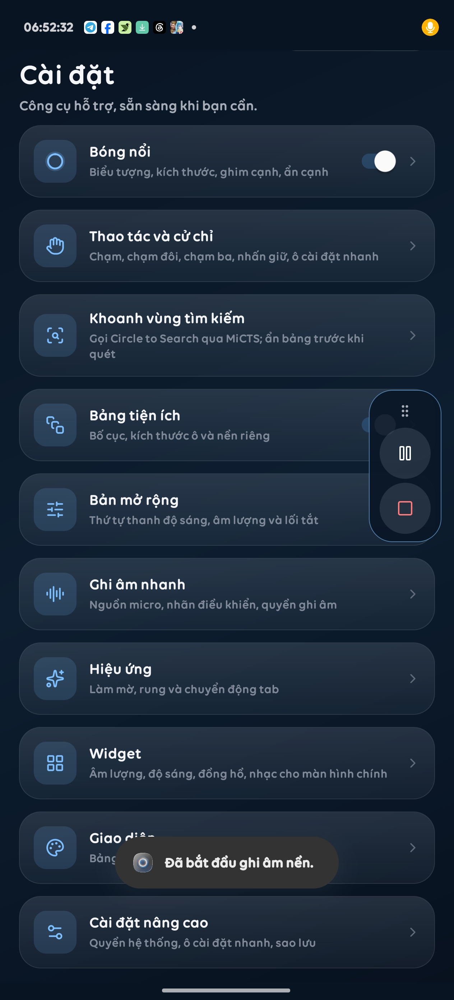

---

## Floating-window and Android ROM compatibility | Tương thích cửa sổ nổi và ROM Android

**EN**  
Panels Assistive is intended for use across a range of Android devices and manufacturer interfaces. Compatibility options may be relevant to:

- **ColorOS** — OPPO
- **realme UI** — realme
- **OxygenOS** — OnePlus
- **HyperOS / MIUI** — Xiaomi, Redmi and POCO
- **HarmonyOS** — Huawei devices, where the required Android compatibility layer and APIs are available
- **Other Android interfaces**, such as OriginOS and MagicOS, subject to device support

Floating-window behavior is controlled partly by the operating system. Availability can differ by phone model, OS version, region, manufacturer restrictions and app permissions. Therefore, compatibility does not mean that every feature or freeform-window mode is guaranteed on every device.

**VI**  
Panels Assistive hướng đến khả năng sử dụng trên nhiều thiết bị Android và giao diện tùy biến của các nhà sản xuất. Các tùy chọn tương thích có thể liên quan đến:

- **ColorOS** — OPPO
- **realme UI** — realme
- **OxygenOS** — OnePlus
- **HyperOS / MIUI** — Xiaomi, Redmi và POCO
- **HarmonyOS** — thiết bị Huawei trong trường hợp có lớp tương thích Android và API cần thiết
- **Các giao diện Android khác**, như OriginOS và MagicOS, tùy khả năng hỗ trợ của thiết bị

Cách hoạt động của cửa sổ nổi còn phụ thuộc vào hệ điều hành. Khả năng hỗ trợ có thể khác nhau theo mẫu máy, phiên bản hệ điều hành, khu vực, giới hạn của nhà sản xuất và quyền ứng dụng. Vì vậy, tương thích không có nghĩa mọi chức năng hoặc chế độ cửa sổ tự do đều được đảm bảo trên tất cả thiết bị.

---

## Permissions | Quyền ứng dụng

**EN**
Panels Assistive may request permissions when you use features that need them. Examples include:
- **Display over other apps:** for floating elements and overlays.
- **Microphone:** for audio recording.
- **Notifications / media access:** for relevant notification or media features, depending on Android version.
- **Accessibility Service:** optional for basic use; required only for specific actions that rely on Accessibility.

Only grant permissions for features you intend to use. Exact permission names and behavior may vary by Android version and manufacturer.

**VI**
Panels Assistive có thể yêu cầu quyền khi bạn sử dụng chức năng cần đến chúng. Ví dụ:
- **Hiển thị trên ứng dụng khác:** dùng cho thành phần nổi và lớp phủ.
- **Micro:** dùng cho chức năng ghi âm.
- **Thông báo / truy cập đa phương tiện:** phục vụ các tính năng thông báo hoặc đa phương tiện tùy phiên bản Android.
- **Dịch vụ Trợ năng:** không bắt buộc cho sử dụng cơ bản; chỉ cần cho một số thao tác phụ thuộc Trợ năng.

Chỉ cấp những quyền cần thiết cho chức năng bạn muốn sử dụng. Tên quyền và cách hoạt động có thể khác nhau tùy phiên bản Android và nhà sản xuất.

---

## Screenshots | Hình ảnh ứng dụng

A quick visual tour of Panels Assistive.

Một số hình ảnh minh họa giao diện và tính năng của Panels Assistive.

| Floating media | Home screen |
|---|---|
|  |  |
| Settings | Quick controls |
|  |  |
| Recording | Gesture actions |
|  |  |

---

## Notes | Lưu ý

**EN**
- Screenshots are provided to illustrate the interface; actual appearance may vary by device, screen size and system version.
- Some actions require additional permissions or system support.
- This README describes the intended feature set and visible app options; it does not guarantee that every feature has been tested on every Android device.

**VI**
- Ảnh chụp màn hình nhằm minh họa giao diện; giao diện thực tế có thể khác theo thiết bị, kích thước màn hình và phiên bản hệ thống.
- Một số thao tác cần quyền bổ sung hoặc sự hỗ trợ từ hệ điều hành.
- README mô tả nhóm tính năng và tùy chọn thể hiện trong ứng dụng; không khẳng định mọi chức năng đã được kiểm thử trên tất cả thiết bị Android.

---

**Panels Assistive**  
*Make everyday actions easier. | Giúp thao tác hằng ngày thuận tiện hơn.*

